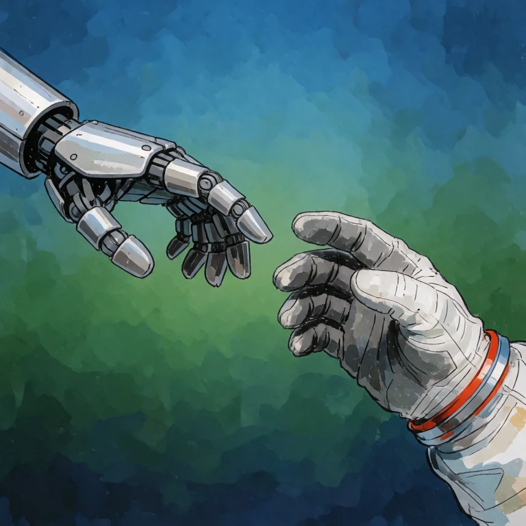

<p align="center">
  
</p>

# DT MCP Client

A macOS app that lets AI agents generate images and video with a [Draw Things](https://drawthings.ai) gRPC server. It runs a local [MCP](https://modelcontextprotocol.io) server, so any MCP-capable agent can call the tools. Generated files are saved to a folder you choose, and the agent gets their paths back.

- **Sandboxed.** The app can only reach the network and the folders you grant it.
- **Local only.** The MCP server listens on `127.0.0.1` and requires a bearer token.
- **Ships with a skill.** A `SKILL.md` teaches agents the workflow, safe settings and error handling, and works with smaller models.

## Tools

| Tool | Purpose |
|---|---|
| `get_server_status` | Check the connection to Draw Things |
| `list_models`, `list_loras`, `list_controlnets`, `list_upscalers` | See what is installed |
| `get_model_recommendations` | Size, sampler, steps, guidance and shift for a model |
| `generate_image` | Text-to-image, img2img, inpaint, ControlNet, LoRAs, upscaling |
| `generate_video` | Video from text or a start image; optionally keeps the last frame (to chain clips) and every frame |
| `extract_frames` | Save the first, last or any frames of an .mp4 as PNGs |
| `process_video` | Upscale, interpolate (smoother or slow motion) or re-time a video; runs locally on the Mac |
| `wait_for_job`, `get_job`, `list_jobs`, `cancel_job` | Follow and control jobs |

Generation is asynchronous: `generate_*` and `process_video` return a `job_id`, and `wait_for_job` returns the output file paths. Video upscaling and interpolation use Apple's on-device ML on recent macOS and fall back to a plain resize or cross-fade on older systems; the job note says which ran.

## Setup

1. Open the app and enter your Draw Things server's host, port, TLS setting and shared secret on the **Connection** tab, then **Save & test connection**.
2. On the **Folders** tab, choose an **output folder** (required) and optionally add **input folders** for images you want agents to edit.
3. On the **MCP Server** tab, start the server and copy the configuration snippet into your agent harness. It looks like this:

   ```json
   {
     "mcpServers": {
       "drawthings": {
         "url": "http://127.0.0.1:8765/mcp",
         "headers": { "Authorization": "Bearer <your token>" }
       }
     }
   }
   ```

4. On the **Skill** tab, export the skill folder into your harness's skills directory, or copy the text into the agent's instructions.

Agents can only read images from folders you granted, and the output folder counts. If the harness is itself sandboxed, grant it access to the same folder.

Enable model browsing on the Draw Things server so the list tools can see your models.

## Building

Requires Xcode 27 (Swift 6) and macOS 15 or later. The Draw Things Swift library is expected at `reference/DrawThings-Swift`:

```bash
git clone https://github.com/euphoriacyberware-ai/DrawThings-Swift.git reference/DrawThings-Swift
```

Build and run the tests:

```bash
swift test
```

Build the sandboxed app at `.build/DTMCPClient.app`:

```bash
SIGN_IDENTITY="Apple Development: Your Name (TEAMID)" Scripts/build-app.sh release
```

With no `SIGN_IDENTITY` the app is signed ad hoc, and macOS asks for Keychain access again after every rebuild. A development identity avoids that.

## Distributing

`Scripts/release.sh` builds, signs with hardened runtime, packs a DMG, notarizes it and staples the ticket. You need a **Developer ID Application** certificate and a saved notarytool profile. The header of the script has the one-time setup.

```bash
SIGN_IDENTITY="Developer ID Application: Your Name (TEAMID)" Scripts/release.sh
```

The result is `dist/DT-MCP-Client-<version>.dmg`. The build is for the Mac's own architecture (Apple silicon on an Apple silicon Mac).

## App icon

`Resources/Icon/source.png` is the artwork. After changing it, run `swift Scripts/make-icon.swift` to regenerate `AppIcon.icns`.

## License

MIT. See [LICENSE](LICENSE).
